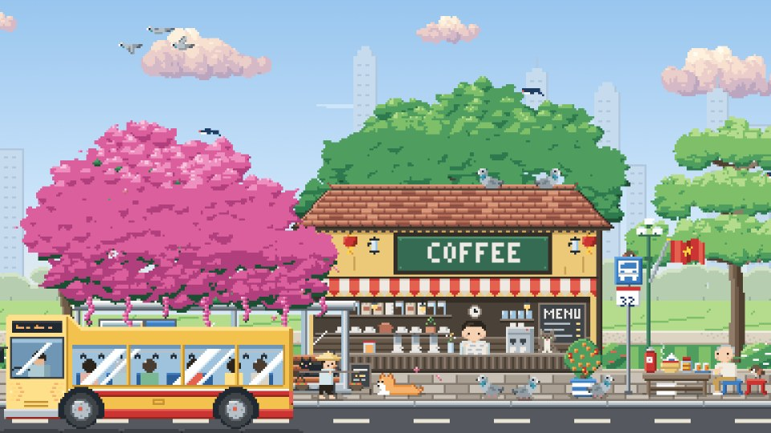
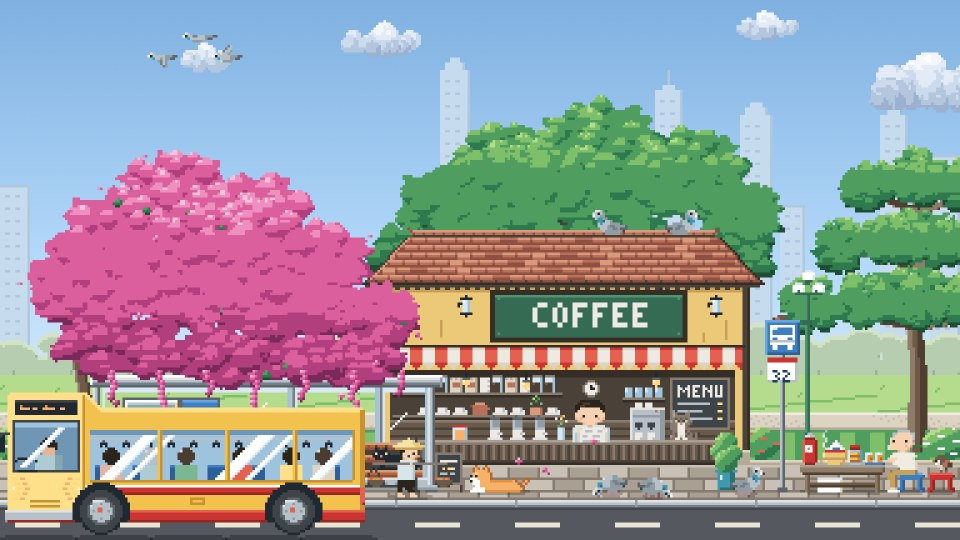
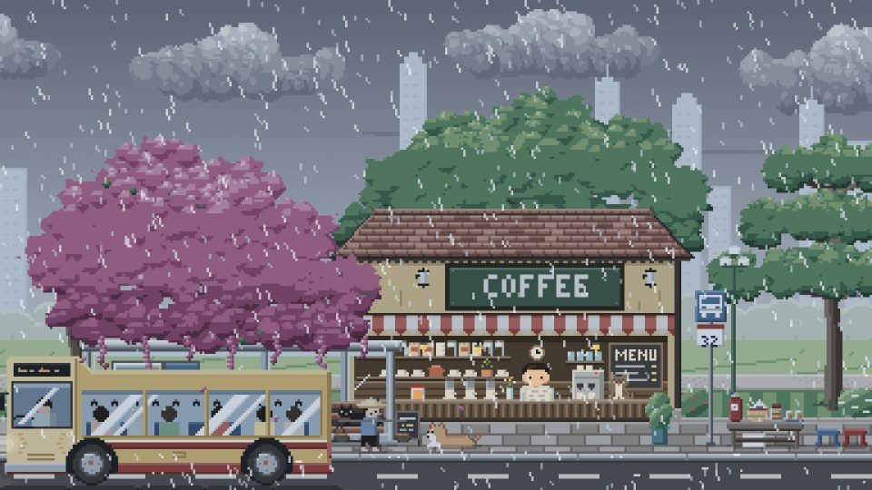
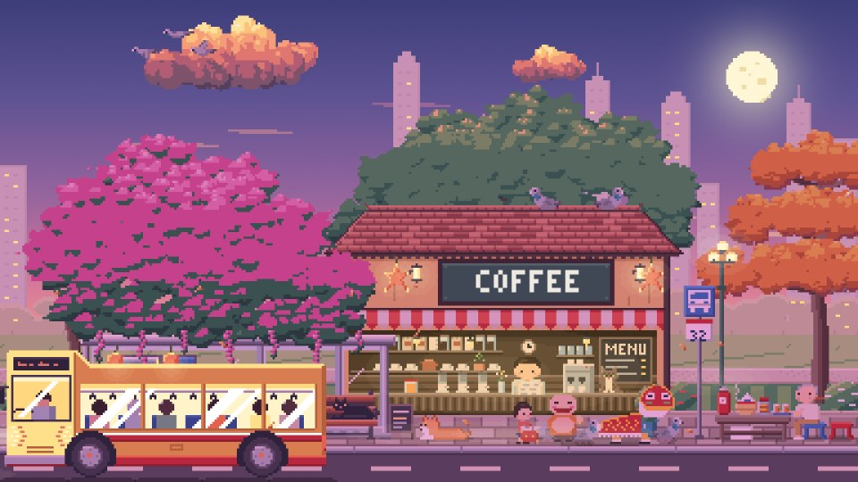
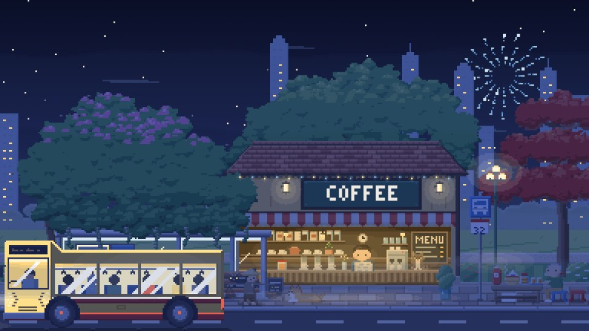
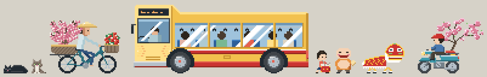
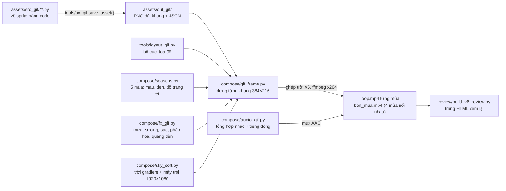

# Trạm Xe Bốn Mùa

Video lofi pixel art về một trạm xe buýt Hà Nội cạnh quán cà phê và công viên, kể bốn mùa bằng ánh sáng, thời tiết và
những thứ đi ngang khung hình. Nhân vật chính là chú mèo mun nằm ngủ trên ghế chờ.

Toàn bộ hình ảnh được **vẽ bằng code**: mỗi sprite là một lưới ký tự (một ký tự = một điểm ảnh) trên bảng màu khoá cứng.
Cảnh được dựng từng khung bằng Python, âm thanh cũng do máy tổng hợp. Không dùng ảnh hay nhạc có bản quyền.

| Xuân · sáng mùng Một Tết | Hạ · trưa nắng | Hạ · mưa rào |
|---|---|---|
|  |  |  |
| **Thu · tối Trung Thu** | **Đông · đêm Giao thừa** | |
|  |  | |



## Thông số

| | |
|---|---|
| Khung logic | **384×216** điểm ảnh, phóng nguyên ×5 → **1920×1080** |
| Nhịp hình | 12 khung/giây (mã hóa ra 30 fps) |
| Vòng lặp cảnh | **24 giây**: mọi chuyển động (xe buýt, người, mèo, chim, mưa, pháo hoa, nhạc) có chu kỳ chia hết cho 24 s |
| Vòng lặp mây | **120 giây** (mây trôi hết một vòng ngang màn hình) → mỗi clip mùa dài 2 phút, lặp khít |
| Bầu trời | gradient mượt + mây pixel kiểu "chùm bông" trôi chậm, vẽ ở 1920×1080 sau cảnh pixel |
| Âm thanh | 48 kHz stereo, nhạc lofi 80 BPM (8 ô nhịp = 24 s) + tiếng động khớp hình, AAC 192 kbps |

## Quy trình dựng video



1. **Vẽ sprite.** Mỗi file trong `assets/src_gif/` vẽ một nhóm sprite và xuất ra `assets/out_gif/<nhóm>/<tên>.png` + `.json`.
2. **Dựng cảnh.** `compose/gif_frame.py` xếp các lớp (trời → nhà xa → cây → quán → trạm → người → xe) theo bố cục,
   áp "look" của từng mùa, chạy các vật chuyển động và hiệu ứng, ra một khung 384×216 cho mỗi thời điểm `t`.
3. **Ghép trời.** Bầu trời được vẽ riêng ở 1920×1080 (`compose/sky_soft.py`). Khung pixel được phóng ×5, rồi chỗ nào
   còn nhìn thấy trời thì lấy lại chi tiết trời độ phân giải cao. Nhờ vậy cảnh vẫn là pixel sắc nét còn trời mượt.
4. **Mã hóa.** Khung 1920×1080 được đẩy thẳng vào ffmpeg (x264, CRF 16) → `loop.mp4` từng mùa và `bon_mua.mp4`.
5. **Âm thanh.** `compose/audio_gif.py` tổng hợp nhạc và tiếng động theo đúng mốc thời gian của hình, rồi ghép vào video.
6. **Xem lại.** `review/build_v6_review.py` gói video thu nhỏ + ảnh vào một file HTML tự chứa để mở bằng trình duyệt.

## Cài đặt

Cần Python 3.12 trở lên và `ffmpeg` (có libx264 và aac).

```bash
git clone https://github.com/PrimarchDatNT/pixel-bus-stop.git
cd pixel-bus-stop
python -m venv .venv
.venv/bin/pip install -r requirements.txt
```

## Dựng video từ đầu

```bash
# 1. Vẽ lại toàn bộ sprite (repo đã có sẵn kết quả trong assets/out_gif/, bước này chỉ cần khi sửa sprite)
.venv/bin/python tools/build_assets.py

# 2. Xem thử một khung tĩnh (nhanh, vài giây)
.venv/bin/python compose/gif_frame.py --scene cafe --season thu --t 10.5
#    -> review/gif_style/v6_cafe/thu/frame.png (384×216) và frame@5x.png (1920×1080)

# 3. Dựng cả 5 mùa, mỗi mùa 120 s, chạy song song 5 tiến trình + video 4 mùa nối nhau
.venv/bin/python compose/gif_frame.py --scene cafe --all --anim 120 --t 10.5
#    -> review/gif_style/v6_cafe/<mùa>/loop.mp4 và review/gif_style/v6_cafe/bon_mua.mp4  (~4 phút trên i5-14400)

# 4. Tổng hợp âm thanh và ghép vào video (chạy lại sau mỗi lần dựng hình)
.venv/bin/python compose/audio_gif.py
#    -> loop.mp4 có tiếng; bản không tiếng giữ ở loop_silent.mp4; file âm thanh loop.wav, bon_mua.wav

# 5. Trang HTML xem lại
.venv/bin/python review/build_v6_review.py
#    -> review/Tram-Xe-Cong-Vien.html
```

Tham số của `compose/gif_frame.py`:

| Tham số | Ý nghĩa |
|---|---|
| `--scene cafe` / `taphoa` / `house` | cảnh: quán cà phê + công viên (bản dùng cho video), quán tạp hóa, hoặc nhà phố cũ (bản 5) |
| `--season xuan` / `ha` / `mua` / `thu` / `dong` | một mùa |
| `--all` | cả 5 mùa (song song), kèm video `bon_mua.mp4` |
| `--anim 120` | dựng video dài 120 s (bỏ đi thì chỉ ra khung tĩnh) |
| `--t 10.5` | thời điểm của khung tĩnh `frame.png` |
| `--jobs 1` | dựng lần lượt từng mùa thay vì song song |

Muốn có video dài (ví dụ 1 giờ cho YouTube) thì lặp file 2 phút, không cần dựng lại:

```bash
ffmpeg -stream_loop 29 -i review/gif_style/v6_cafe/bon_mua.mp4 -c copy tram_xe_1h.mp4
```

## Cách gen asset (sprite)

### Nguyên tắc vẽ

- Mọi sprite vẽ tay bằng code. AI chỉ được thử nghiệm (`assets/src_gif/ai_test/`, `tools/comfy.py`), không dùng cho bản cuối.
- Chỉ dùng màu trong bảng `PALETTE_GIF` (`tools/px_gif.py`, các dải màu đặt tên kiểu `leaf_hl`, `leaf_l`, `leaf`, `leaf_d`).
  `save_asset()` gọi `validate()`, gặp màu lạ là báo lỗi ngay.
- Phong cách: không viền đen quanh nhân vật, mỗi mảng 2–3 sắc độ phẳng, ánh sáng từ trên bên trái, đầu to tròn, mắt 1 điểm ảnh.
- Mỗi sprite có `anchor` là điểm chạm đất (chân, bánh xe), để bộ dựng cảnh đặt đúng chỗ.

### Định dạng xuất

`save_asset(group, name, frames, fps=..., anchor=(x, y), states={...}, notes=...)` ghi ra:

- `assets/out_gif/<group>/<name>.png`: các khung xếp thành một dải ngang, kích thước thật (1×).
- `assets/out_gif/<group>/<name>.json`: `frameW`, `frameH`, `frames`, `fps`, `anchor`, `states` (tên trạng thái → danh sách
  chỉ số khung, ví dụ `"sleep": [0,0,0,0,1,1,1,1,...]`), `loop`, `notes`.
- `assets/out_gif/<group>/_preview/<name>@4x.png` (+ `.gif` nếu có chuyển động) để xem nhanh.

Số khung × nhịp của mỗi trạng thái phải chia hết cho vòng 24 s; bộ dựng cảnh kiểm tra và cảnh báo nếu không.

### Ví dụ: mèo mướp ngồi trên quầy (`assets/src_gif/park/people.py`)

```python
from tools.px_gif import *          # grid(), save_asset(), bảng màu

TAB = {"T": "wood_l", "t": "wood", "H": "wood_hl", "W": "wc_l", "w": "wc", "Y": "leaf_hl", "p": "pk_l", "k": "wood_d"}
CAT0 = [
    ".H.....H....",
    ".HT...TT....",
    ".HTTTTTT....",
    ".TtTtTtT....",
    "HTYkTkYTT...",      # Y = mắt xanh, k = đồng tử
    "TTTWpWTTt...",      # p = mũi hồng
    ...
]
CAT_BLINK = list(CAT0); CAT_BLINK[4] = "HTkkTkkTT..."      # các khung khác chỉ sửa vài dòng

cats = [grid(f, TAB) for f in (CAT0, CAT_BLINK, CAT_TAIL, CAT_EAR)]
save_asset("actors", "cat_tabby", cats, fps=4, anchor=(5, 11),
           states={"idle": [0, 0, 0, 2, 0, 0, 1, 0, 0, 2, 0, 3]})    # 12 bước × 1/4 s = 3 s, chia hết 24 s
```

Sprite lớn (quán, cây, xe buýt) vẽ bằng các hàm hình học trong `tools/px.py` (`rect`, `ellipse`, `line`, `poly`, `put`)
thay vì lưới ký tự. Toạ độ chung của cảnh (mặt đất, mái trạm, vị trí quán...) nằm ở `tools/layout_gif.py`.

### Script nào sinh ra asset nào

`tools/build_assets.py` chạy các script dưới đây theo thứ tự. Thêm tên nhóm để chỉ chạy một phần, ví dụ
`tools/build_assets.py park bus`. Repo đã được kiểm tra: dựng lại từ một bản clone sạch cho ra đúng từng điểm ảnh như
các file trong `assets/out_gif/`.

| Script | Asset |
|---|---|
| `env_b/run.py` | `env/sky`, `distance`, `house`, `ground` (nền của cảnh nhà phố) |
| `shelter_b/back.py`, `front.py`, `seats.py`, `stop_sign.py` | trạm xe: vách kính, mái, hai ghế gỗ, biển dừng xe số 32 |
| `shelter_b/bloom_lobes.py`, `petals.py` | khóm hoa giấy trên mái trạm, cánh hoa bay |
| `actors_b/chars.py` | người đi bộ đội nón lá, học sinh, cô chờ xe, chủ quán, ông uống trà... |
| `actors_b/cat_black.py` | mèo mun ngồi trên mái trạm (cảnh nhà phố) |
| `actors_b/props.py` | chim sẻ, bồ câu, góc trà đá, ghế nhựa, hơi nước |
| `actors_b/bus.py` | xe buýt 32, khói xe |
| `season/tet.py` | đèn lồng, cờ, cây quất, xe máy chở đào, chim én, cánh đào |
| `season/thu.py` | đèn ông sao, đội múa lân, trẻ em rước đèn, lá vàng |
| `season/skies.py` | trời pixel cũ của từng mùa + trăng rằm (dùng trong trời mới) |
| `park/park.py` | công viên: hàng cây và nhà cao tầng xa, bãi cỏ, cây xà cừ, cây bàng, cột đèn, quán cà phê / tạp hóa |
| `park/people.py` | mèo mướp trên quầy, mèo mun nằm trên ghế chờ (ngủ / ngẩng nhìn / nhìn theo xe) |
| `park/bike.py` | xe đạp hoa, mỗi mùa một loại hoa |

Các thư mục `assets/src_gif/env`, `shelter`, `actors` (không có `_b`) là bố cục cũ (bản 4), giữ lại làm lịch sử.

## Dựng cảnh

- **Thứ tự lớp và vị trí**: `BASE_ORDER` / `BASE_PLACE` trong `compose/gif_frame.py`. Cảnh `cafe` thay nhà phố bằng quán
  và công viên qua `park_order()` và `PARK_PLACE`.
- **Mùa** (`compose/seasons.py`): mỗi mùa là một bộ ghi đè lên cảnh hè. Gồm `add` (thêm lớp: đèn lồng, cờ, đèn ông sao),
  `hide`, `recolor` (đổi màu quần áo, lá), `grade` (ánh chiều, ánh đêm), `soft` / `emit` (vùng sáng: cửa sổ, biển quán,
  đèn đường), `glows`, và `fx` (mưa, sương, sao, pháo hoa). Cảnh công viên ghi đè thêm qua `PARK` và `season_for()`.
- **Vật chuyển động**: xe buýt, xe đạp hoa, người đi bộ, chim, đội múa lân... nằm trong `draw_movers()`. Mỗi thứ có chu kỳ
  chia hết cho 24 s.
- **Kịch bản theo thời gian**: `TIMELINES`, ví dụ mèo mun ngủ → ngẩng đầu khi xe tới → nhìn theo xe đi → ngủ lại.
- **Bầu trời** (`compose/sky_soft.py`):
  - Gradient theo `SKY_GRAD` trong `seasons.py`, quầng trăng theo `MOON_GLOW`.
  - Mây theo `PIXEL_CLOUDS`: mỗi đám là một đống cụm tròn tô 6–8 sắc độ theo bảng `RAMPS` của từng mùa, cộng các vệt
    mây mỏng.
  - `CLOUD_STYLE = "soft"` chuyển sang mây mềm vẽ kiểu tranh.
  - Mây trôi sang phải và quay vòng sau `CLOUD_PERIOD = 120` giây.

## Âm thanh

Toàn bộ âm thanh nằm trong `compose/audio_gif.py`, chỉ dùng numpy và scipy.

- **Nhạc**: Rhodes (FM), bass, trống nhẹ, giai điệu kiểu đàn bầu, tiếng đĩa than lạo xạo. Mỗi mùa một vòng hợp âm riêng;
  đông dùng thêm hộp nhạc.
- **Tiếng động bám đúng mốc của hình**: xe buýt vào bến (phanh, xì hơi, mở đóng cửa), chuông xe đạp hoa, chim, tách chén
  trong quán, ve, mưa và sấm, gió và dế, trống lân, pháo hoa, chuông chùa.
- **Lặp khít**: mọi âm "quấn vòng" qua mốc 24 s; vang và lọc tính theo kiểu vòng tròn nên chỗ nối không bị hụt hay lặp.

## Quy tắc để video lặp khít

- Mọi hàm chỉ phụ thuộc `t`. Thứ gì ngẫu nhiên thì sinh một lần từ hạt giống (seed) cố định, không random theo khung.
- Chu kỳ của mọi chuyển động chia hết cho 24 s; riêng mây là 120 s, và 120 chia hết cho 24.
- Kiểm tra: dựng khung ở `t` và `t + 120` rồi so từng điểm ảnh, phải trùng nhau.

## Cấu trúc thư mục

```
assets/src_gif/        script vẽ sprite (bản hiện tại: *_b/, park/, season/)
assets/out_gif/        sprite đã xuất: PNG dải khung + JSON  (_mock/: ảnh phác bố cục)
assets/src*, out*      các thử nghiệm cũ: v1 (px), v2 (2.5D / 3D / AI), v3
compose/               dựng cảnh, mùa, hiệu ứng, bầu trời, âm thanh
tools/                 bộ công cụ pixel (px.py, px_gif.py), bố cục, build_assets.py, client ComfyUI
review/                script dựng trang HTML xem lại (kết quả và video không đưa lên git)
docs/img/              ảnh minh hoạ cho README
PLAN.md, SPEC*.md, STYLE*.md   kế hoạch, đặc tả, ghi chú phong cách qua từng bản
```

## Lịch sử phiên bản

| Bản | Nội dung |
|---|---|
| 1 | khung 480×270, palette Endesga 32, phác cảnh tĩnh |
| 2 | thử 2.5D, dựng 3D và AI (ComfyUI) cho phong cách |
| 3 | thử ghép AI + pixel hoá |
| 4–5 | phong cách "GIF" pastel 384×216, vẽ tay hoàn toàn; cảnh nhà phố Hà Nội + trạm xe + hoa giấy, 5 mùa |
| 6 | đổi nhà phố thành quán cà phê cạnh công viên; mèo mun nằm ghế chờ, mèo mướp trong quán, xe đạp hoa, xe buýt mới, âm thanh |
| 6c | trời gradient, mây pixel kiểu chùm bông trôi chậm (clip 2 phút), dựng song song |

## Không có trong repo

Các file này đã được `.gitignore` loại ra và đều dựng lại được bằng các lệnh ở trên:

- `review/gif_style/`: khung hình, `loop.mp4`, `bon_mua.mp4`, file âm thanh. Dung lượng hơn 1 GB.
- `review/*.html`: trang xem lại, vì có nhúng video.
- `assets/out_v2/`, `assets/out_v3/`: ảnh dựng thử của bản 2 và 3, vài trăm MB, không dùng cho video hiện tại.
- `refs/`: ảnh tham khảo của người khác (GIF trên Pinterest, khung hình từ video khác). Không phân phối lại.
